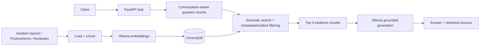

# IncidentGraph AI

**Evidence-grounded incident investigation with local LLMs, conversational RAG, and measurable retrieval quality.**

IncidentGraph AI is a local-first prototype that answers questions about operational incidents using incident reports, postmortems, and runbooks. It combines LangChain, ChromaDB, Ollama, and FastAPI to retrieve relevant evidence, resolve conversational follow-ups, and return answers alongside retrieved document paths.

> **Project status:** Phase 1 backend implemented and evaluated. The Streamlit interface is planned, not yet implemented. Despite the name, the current version does **not** contain a knowledge graph; graph-enhanced retrieval is Phase 2.

## What it does

- **Evidence-grounded Q&A:** Answers questions using retrieved incident evidence and is instructed to acknowledge insufficient evidence.
- **Conversational follow-ups:** Rewrites questions using per-session chat history and tracks explicitly mentioned incident IDs.
- **Metadata-aware retrieval:** Filters by document category (runbooks, postmortems, incident reports) when the question names one.
- **Incident-aware retrieval:** Searches ChromaDB and filters candidates by incident ID in retrieved chunk text.
- **Source references:** Returns deduplicated paths of retrieved documents. These are *not* verified claim-level citations.
- **Local inference:** Uses Ollama `llama3.2:1b` for rewriting and answer generation, and `nomic-embed-text` for embeddings.
- **Evaluation and tests:** Includes retrieval evaluation, answer generation evaluation, and FastAPI regression tests.

## Architecture



See [Architecture documentation](docs/ARCHITECTURE.md) for request flow, design details, and limitations.

## Evaluation snapshot

| Metric | Observed result | Scope |
|---|---:|---|
| Hit@3 | **100%** | 30 synthetic questions |
| Recall@3 | **100%** | 30 synthetic questions |
| MRR@3 | **100%** | 30 synthetic questions |
| Completed answer generations | **30/30** | Latest answer evaluation |
| Mean generation-pipeline latency | **1.57 s** | One local evaluation run; hardware-dependent |
| Provisional manual answer correctness | **27/30 (90%)** | Non-blind manual assessment; not independently validated |
| API regression tests | **6/6 passed** | FastAPI smoke/regression suite; 18.74 s total |

**Interpretation:** Perfect retrieval on this small synthetic benchmark does not imply perfect answer accuracy or generalization to real incidents. The correctness figure is provisional, and a verified faithfulness score is not available. See the [evaluation report](evaluation/EVALUATION_REPORT.md) for methods, failures, and caveats.

## Tech stack

**Python · LangChain · ChromaDB · Ollama · FastAPI · Pydantic · pytest**

- Generation and rewriting: `llama3.2:1b` (`temperature=0`)
- Embeddings: `nomic-embed-text`
- Persistent vector store: ChromaDB
- API: `GET /health`, `POST /ask`
- Dataset: 10 synthetic incidents, 10 postmortems, 10 runbooks, 30 QA benchmark questions

## Local setup

**Prerequisites:** Python, [Ollama](https://ollama.com/), and the project files. The commands below assume the repository contains `main.py`, `Retriver.py` (current filename), `evaluation/`, and `incidentgraph_dataset/`.

1. Create and activate a Python environment:

   ```powershell
   python -m venv .venv
   .\.venv\Scripts\Activate.ps1
   ```

2. Install the application and test dependencies:

   ```powershell
   pip install fastapi uvicorn langchain-core langchain-chroma langchain-ollama langchain-community langchain-text-splitters pydantic pytest httpx
   ```

   Once a verified `requirements.txt` is committed, prefer `pip install -r requirements.txt`.

3. Start Ollama if it is not already running, then download the required models:

   ```powershell
   ollama pull llama3.2:1b
   ollama pull nomic-embed-text
   ```

4. Build the vector index if `incidentgraph_dataset/chroma_db/` does not exist:

   ```powershell
   python incidentgraph_dataset/starter_ingest.py
   ```

   The starter ingestion script loads the Markdown corpus, splits it into chunks, embeds them, and persists ChromaDB locally. The structured CSVs are **not** indexed in the Phase 1 pipeline.

5. Start the API from the repository root:

   ```powershell
   python -m uvicorn main:app --reload
   ```

   Interactive API documentation is available at `http://127.0.0.1:8000/docs`.

## Example API request

```powershell
Invoke-RestMethod -Method Post `
  -Uri http://127.0.0.1:8000/ask `
  -ContentType 'application/json' `
  -Body '{"question":"What caused INC-001?","session_id":"demo-1"}'
```

The endpoint returns JSON with these fields:

```json
{
  "answer": "<generated answer>",
  "question": "What caused INC-001?",
  "source": ["<retrieved document path>"],
  "search_question": "What caused INC-001?",
  "session_id": "demo-1"
}
```

For a follow-up, reuse the same `session_id` and ask a question such as `How can we prevent it?`.

## Reproduce evaluation and tests

With Ollama running and the Chroma index populated:

```powershell
python evaluation/evaluate_retrieval.py
python evaluation/evaluate_answers.py
python -m pytest evaluation/test_api.py -v
```

The answer evaluation writes `evaluation/answer_result.csv`. Review answers against ground truth; successful requests are not equivalent to correct answers.

## Known limitations

- **Synthetic data:** Small, curated dataset; no demonstrated production generalization.
- **Entity confusion:** The local 1B model can confuse an incident's primary failed job with an upstream dependency (e.g., `JOB-553` vs. `JOB-552` in INC-008).
- **Retrieval edge cases:** Incident filtering relies on IDs appearing in chunk text, which can exclude relevant chunks.
- **Source attribution:** Returned source paths represent retrieved evidence, not verified claim-level support.
- **Session persistence:** Conversation history is stored in process memory, without persistence or multi-worker synchronization.
- **No production integrations:** No authentication, monitoring, operational tool access, or production actions.

## Roadmap

### Phase 1 — Conversational RAG MVP
- [x] Ingest incident reports, postmortems, and runbooks
- [x] Local embeddings, ChromaDB search, and grounded generation
- [x] Conversational rewriting and metadata-aware retrieval
- [x] Retrieval and answer evaluation
- [x] FastAPI endpoints and six regression tests
- [x] Architecture and evaluation documentation
- [ ] Streamlit chat frontend

### Phase 2 — Graph-enhanced investigation *(planned)*
- [ ] Extract structured incident entities: jobs, services, deployments, errors
- [ ] Build explicit relationships (`PRIMARY_JOB`, `DEPENDS_ON`, `CAUSED_BY`)
- [ ] Add graph traversal and hybrid graph/vector retrieval
- [ ] Compare vector-only, structured-field, and graph-enhanced baselines on **new held-out multi-hop questions**

### Phase 3 — Agentic investigation *(planned)*
- [ ] Introduce bounded, read-only investigation tools
- [ ] Orchestrate multi-step investigations and trace tool decisions
- [ ] Evaluate tool correctness, evidence coverage, failure handling, and latency
- [ ] Require explicit human authorization for any future operational side effects

## Data and responsible use

The starter dataset is **entirely fictional** and contains no real customer or internal enterprise records. This project is a demonstration of local incident-investigation workflows, not an autonomous production incident-response system.

## Repository notes

Keep `.venv/`, `__pycache__/`, `.pytest_cache/`, and the local `incidentgraph_dataset/chroma_db/` index out of Git. Commit the ingestion script and source documents so others can rebuild the index. Confirm all project-specific dependencies and paths before publishing.
