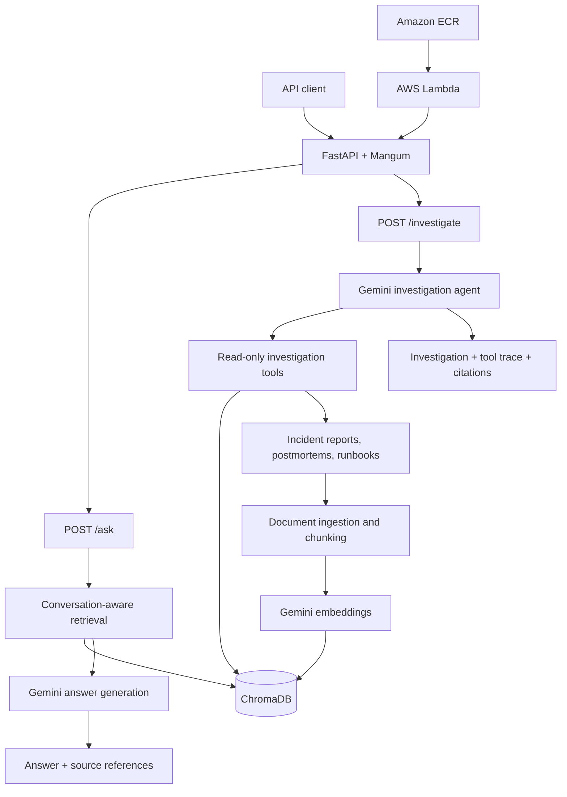

# IncidentGraph AI

**Evidence-grounded incident investigation using conversational RAG, Gemini-powered agents, ChromaDB, and serverless deployment on AWS.**

IncidentGraph AI is an AI-powered incident investigation system designed to help engineers understand operational failures using incident reports, postmortems, and runbooks.

## What it does

> **Project status:** The conversational RAG backend, Gemini-based investigation agent, Docker containerization, and AWS Lambda deployment are implemented. AWS Lambda `/health` testing has passed. End-to-end cloud validation of `/ask` and `/investigate` is pending because the Gemini API free-tier request quota was exhausted. Graph-enhanced retrieval remains planned.

## Features

### 1. Evidence-grounded conversational RAG

- Retrieve relevant information from incident reports, postmortems, and operational runbooks.
- Generate answers using retrieved context.
- Support conversational follow-up questions through session-based history.
- Apply document-type and incident-aware retrieval filters.
- Return source document paths alongside generated answers.

### 2. Agentic incident investigation

- Use Gemini tool calling to coordinate incident investigations.
- Retrieve incident details, search incident documents, and access relevant runbooks.
- Execute bounded, read-only investigation steps.
- Record tool execution traces.
- Return structured investigation results and source references.
- Perform citation validation checks.

### 3. Docker containerization

- Package the FastAPI application and dependencies into a Docker image.
- Use an AWS Lambda-compatible Python 3.12 base image.
- Support local Lambda invocation testing.
- Keep credentials outside the container image.

### 4. AWS serverless deployment

- Store the Docker image in Amazon Elastic Container Registry (ECR).
- Run the application using AWS Lambda.
- Integrate FastAPI with the Lambda runtime through Mangum.
- Execute the application on demand without an always-running server.
- Use CloudWatch for Lambda execution logs.

## Architecture



The current implementation uses vector retrieval and document tools. An explicit knowledge graph has not yet been implemented.

## Technology stack

| Layer | Technologies |
|---|---|
| Programming language | Python |
| API | FastAPI, Pydantic, Mangum |
| LLM | Google Gemini |
| Embeddings | Gemini Embedding |
| AI orchestration | LangChain |
| Vector database | ChromaDB |
| Containerization | Docker |
| Cloud deployment | AWS Lambda, Amazon ECR |
| Monitoring | Amazon CloudWatch |
| Testing and evaluation | pytest, retrieval and answer evaluation scripts |

The original Phase 1 prototype used Ollama with `llama3.2:1b` and `nomic-embed-text`. The current deployment uses Gemini for generation and embeddings.

## Dataset

The project uses a fictional incident investigation dataset containing:

- 10 incident reports
- 10 postmortems
- 10 runbooks
- 30 synthetic benchmark questions

The dataset is designed to simulate incident investigation scenarios without exposing confidential production information.

## Local setup

### Prerequisites

- Python 3.12
- Google Gemini API key
- Docker Desktop (for containerized execution)

### 1. Clone the repository

```bash
git clone https://github.com/AmanPatil21/IncidentGraph-AI.git
cd IncidentGraph-AI
```

### 2. Create a Python environment

```powershell
python -m venv .venv
.\.venv\Scripts\Activate.ps1
```

### 3. Install dependencies

```powershell
pip install -r requirements.txt
```

### 4. Configure environment variables

Create a `.env` file in the repository root.

```env
GOOGLE_API_KEY=your_gemini_api_key
GEMINI_MODEL=gemini-3.8-flash
GEMINI_EMBEDDING_MODEL=models/gemini-embedding-001
```

Use the API-key variable name expected by the installed Gemini integration and application configuration.

**Never commit `.env` or API credentials to GitHub.**

### 5. Build the vector database

```powershell
python incidentgraph_dataset/starter_ingest.py
```

This creates the persistent ChromaDB index under:

```text
incidentgraph_dataset/chroma_db/
```

The index is intentionally excluded from Git and must be generated before running the retrieval endpoints or building the deployment image.

### 6. Run the FastAPI application

```powershell
python -m uvicorn main:app --reload
```

Open:

`http://127.0.0.1:8000/docs`

## API endpoints

### GET /health

Checks whether the API application is responding.

Example response:

```json
{
  "status": "ok"
}
```

### POST /ask

Answers incident-related questions using conversational retrieval.

Example request:

```json
{
  "question": "What caused INC-001?",
  "session_id": "demo-1"
}
```

The response includes the generated answer, question, search question, session ID, and retrieved document paths.

### POST /investigate

Runs a bounded investigation using Gemini and read-only tools.

Example request:

```json
{
  "question": "Investigate INC-001 and identify its root cause.",
  "max_steps": 3
}
```

The investigation workflow can retrieve incident details, search related evidence, access runbooks, and return a structured result with a tool trace and citation validation information.

## Docker deployment

The project uses the official AWS Lambda Python 3.12 container base image.

### Build the image

```powershell
docker buildx build --platform linux/amd64 --provenance=false --sbom=false --load -t incidentgraph-ai:latest .
```

### Run the Lambda container locally

```powershell
docker run --rm --platform linux/amd64 -p 9000:8080 --env-file .env --name incidentgraph-ai incidentgraph-ai:latest
```

The Lambda Runtime Interface Emulator accepts invocation events at:

`http://localhost:9000/2015-03-31/functions/function/invocations`

The containerized `/health` and `/ask` endpoints have been tested successfully locally.

## AWS Lambda deployment

The application is deployed as a container-based AWS Lambda function.

| Configuration | Value |
|---|---|
| AWS Region | `us-east-1` |
| ECR repository | `incidentgraph-ai` |
| Lambda function | `incidentgraph-ai` |
| Runtime | Python 3.12 container image |
| Architecture | x86_64 |
| Memory | 1,024 MB |
| Timeout | 120 seconds |
| Ephemeral storage | 512 MB |

The Docker image is stored in Amazon ECR and executed through AWS Lambda using Mangum.

The deployment includes a prebuilt ChromaDB index. On AWS Lambda, the application copies the index into writable temporary storage when necessary.

### Deployment validation

| Test | Status |
|---|---|
| Docker image build | Passed |
| Local Docker `/health` | Passed |
| Local Docker `/ask` | Passed |
| AWS Lambda function creation | Passed |
| AWS Lambda `/health` | Passed |
| AWS Lambda `/ask` | Pending successful Gemini quota availability |
| AWS Lambda `/investigate` | Pending |
| HTTPS Function URL | Not yet configured |

The AWS `/ask` request reached the Gemini API but was rejected after the free-tier daily request quota was exhausted. This does not establish a successful end-to-end cloud inference test.

## Evaluation

The original Phase 1 implementation was evaluated on a small synthetic benchmark.

| Metric | Historical Phase 1 result |
|---|---:|
| Hit@3 | 100% |
| Recall@3 | 100% |
| MRR@3 | 100% |
| Completed answer generations | 30/30 |
| Mean generation-pipeline latency | 1.57 seconds |
| Provisional manual answer correctness | 27/30 (90%) |
| API regression tests | 6/6 passed |

These results were collected using the original Ollama-based pipeline and should not be interpreted as performance measurements of the current Gemini-based or AWS-hosted implementation.

See `evaluation/EVALUATION_REPORT.md` for the original methodology and limitations.

## Project roadmap

### Phase 1 — Conversational RAG MVP

- [x] Ingest incident reports, postmortems, and runbooks
- [x] Implement ChromaDB vector retrieval
- [x] Support conversational follow-ups
- [x] Add metadata-aware and incident-aware filtering
- [x] Build FastAPI endpoints
- [x] Implement retrieval and answer evaluation
- [x] Document the initial architecture

### Phase 2 — Agentic incident investigation

- [x] Integrate Gemini with LangChain
- [x] Implement read-only investigation tools
- [x] Add multi-step tool orchestration
- [x] Capture tool execution traces
- [x] Add citation validation checks
- [x] Test successful agent execution locally
- [ ] Complete successful AWS Lambda agent validation
- [ ] Expand agent evaluation and failure-handling tests

### Phase 3 — Docker containerization

- [x] Create Lambda-compatible Dockerfile
- [x] Add `.dockerignore`
- [x] Containerize FastAPI, ChromaDB, and LangChain
- [x] Test Lambda invocation locally
- [x] Verify containerized RAG functionality
- [x] Build an x86_64-compatible image

### Phase 4 — AWS serverless deployment

- [x] Create private Amazon ECR repository
- [x] Push Docker image to ECR
- [x] Configure Lambda execution role
- [x] Deploy container image to AWS Lambda
- [x] Configure Gemini API credentials
- [x] Verify `/health` on AWS Lambda
- [ ] Verify successful `/ask` response on AWS Lambda
- [ ] Verify successful `/investigate` response on AWS Lambda
- [ ] Configure a protected HTTPS endpoint

### Phase 5 — Graph-enhanced retrieval

- [ ] Extract structured entities from incident documents
- [ ] Build relationships between services, jobs, deployments, and failures
- [ ] Implement graph traversal
- [ ] Combine graph and vector retrieval
- [ ] Evaluate multi-hop investigation performance against vector-only retrieval

### Phase 6 — Production hardening

- [ ] Add authentication and request protection
- [ ] Improve API quota and retry handling
- [ ] Add structured logging and latency monitoring
- [ ] Expand automated tests and evaluations
- [ ] Add persistent conversation state
- [ ] Implement deployment automation
- [ ] Build an interactive frontend

## Known limitations

- **Synthetic dataset:** The system has not been validated on real production incidents.
- **Gemini API limits:** Free-tier quotas and temporary service failures can interrupt generation.
- **Citation validation:** Source-reference checks do not guarantee that every generated claim is supported by evidence.
- **In-memory sessions:** Conversation history is not persistent across Lambda instances or cold starts.
- **Local vector index:** The current deployment packages a prebuilt ChromaDB index instead of using a managed vector database.
- **Agent execution:** Investigation tools are read-only and do not perform production remediation.
- **Graph retrieval:** An explicit incident knowledge graph is planned but not implemented.
- **Cloud validation:** Successful Gemini-backed inference on AWS Lambda remains to be verified.

## Responsible use

All incident reports, postmortems, and runbooks in the starter dataset are fictional.

IncidentGraph AI is a research and engineering prototype intended to demonstrate evidence-grounded incident investigation, AI tool orchestration, and serverless application deployment. It is not an autonomous production incident-response system.

## Repository hygiene

The following files and directories should remain excluded from Git:

- `.env`
- `.venv/`
- `__pycache__/`
- `.pytest_cache/`
- `incidentgraph_dataset/chroma_db/`

Never commit API keys, AWS access credentials, or other secrets.
