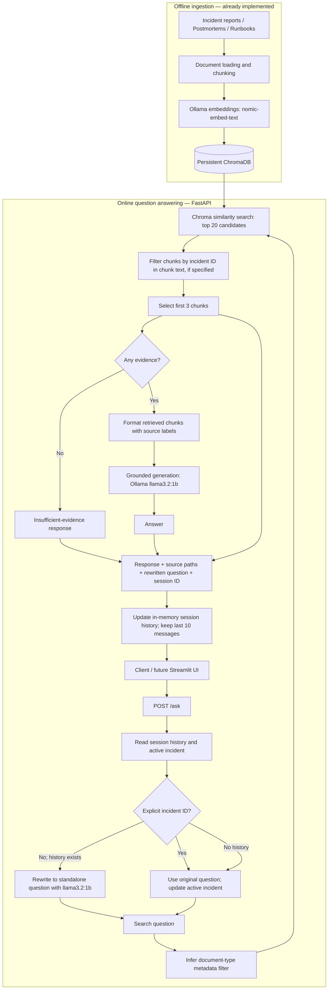

# IncidentGraph AI — Phase 1 Architecture

## Scope

Phase 1 is a local, evidence-grounded conversational retrieval-augmented generation (RAG) backend for enterprise incident investigation. It searches incident reports, postmortems, and runbooks. Despite the project name, **Phase 1 does not contain a knowledge graph**. The Streamlit frontend is planned but not yet implemented.

## System architecture



> The diagram depicts the observed retrieval and answer-generation flow. The precise ingestion implementation (chunk sizes, overlap, and file loaders) should be verified against the ingestion script before adding those details.

## Runtime components

| Component | Technology | Responsibility |
|---|---|---|
| API | FastAPI (`main.py`) | `GET /health` and `POST /ask` |
| Orchestration | LangChain (`Retriver.py`) | Question rewriting, retrieval, prompt formatting, answer generation |
| Chat model | Ollama `llama3.2:1b` | Structured question rewriting and grounded response generation; temperature 0 |
| Embeddings | Ollama `nomic-embed-text` | Vector representations for retrieval |
| Vector store | ChromaDB | Persistent embeddings and document metadata |
| Session state | Python dictionaries | Conversation messages and active incident IDs, per session |
| Evaluation | Python scripts / pytest | Retrieval metrics, answer generation, API regression tests |

## Request and response contract

`POST /ask`

Request:

```json
{
  "question": "What caused INC-001?",
  "session_id": "demo-session"
}
```

Response shape:

```json
{
  "answer": "<generated grounded answer>",
  "question": "What caused INC-001?",
  "source": ["<retrieved document path>"],
  "search_question": "What caused INC-001?",
  "session_id": "demo-session"
}
```

`source` is a **list of retrieved document paths**, not verified claim-level citations. `session_id` defaults to `"default"` if omitted.

`GET /health` returns `{"status": "ok"}`. This checks API responsiveness; it does not independently check Ollama or ChromaDB readiness.

## Retrieval behavior

1. If the question explicitly contains an incident ID (`INC-###`), use it directly and track it for that session.
2. Otherwise, with existing chat history, use the LLM to rewrite the follow-up into a standalone question. If rewriting fails validation, fall back to the original question and optionally prepend the tracked incident ID.
3. Detect document-type terms such as `runbook`, `postmortem`, or `incident report` and apply a Chroma `document_type` filter when matched.
4. Retrieve up to 20 semantically similar chunks.
5. When an incident ID is present, retain only chunks whose **text** includes that ID.
6. Pass the first three remaining chunks to the answer model. If none remain, return an insufficient-evidence response.
7. Return the answer and deduplicated source paths; store the latest conversation messages in process memory.

## Evaluation snapshot

- Retrieval: Hit@3, Recall@3, and MRR@3 reported as 100% on a **30-question synthetic benchmark**.
- Answer generation: 30/30 requests completed; approximately 1.57 seconds mean generation time in the evaluated run.
- Answer correctness: 27/30 (90%) **provisional manual assessment**, not an independently validated quality metric.
- API: 6/6 regression tests passed in 18.74 seconds.

See [`../evaluation/EVALUATION_REPORT.md`](../evaluation/EVALUATION_REPORT.md) for methodology, caveats, and individual failure analysis.

## Known limitations

- A small local `llama3.2:1b` model can confuse primary incident entities with upstream causes (for example, `JOB-553` versus `JOB-552` in INC-008).
- Incident-ID filtering uses chunk text rather than dedicated incident metadata, so relevant chunks without the ID may be excluded.
- Source paths indicate retrieved documents, not which passages support each claim.
- Sessions are stored in memory, are not persistent across restarts, and are not suitable for multi-worker deployment without external storage.
- `/health` is a lightweight liveness endpoint, not a full dependency health check.
- The evaluation corpus is small and synthetic; results should not be generalized to production incidents.

## Planned extensions (not yet implemented)

**Phase 2 — Graph-enhanced RAG:** extract incident, job, deployment, and service entities; model relationships; compare vector-only, structured-fact, and graph-plus-vector retrieval on multi-hop questions.

**Phase 3 — Agentic investigation:** orchestrate read-only investigation tools, preserve evidence provenance, and evaluate multi-step reasoning, reliability, and latency.

**UI:** Add a Streamlit chat frontend to the existing FastAPI API after Phase 1 backend documentation is complete.
